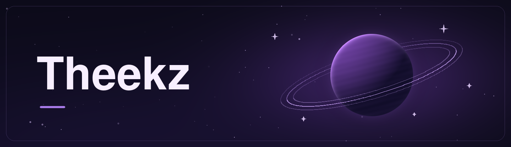

  

<h1 align="center">Hey, I'm Theekz</h1>

I build lofi-inspired web experiences around gaming and music.

  <a href="https://theekz.vercel.app"><strong>Visit my site ↗</strong></a>
  &nbsp;·&nbsp;
  <a href="https://github.com/teudwara-beep/v0-calm-gamer-profile">View the code</a>

## Featured project

**[Theekz — Gamer Profile](https://github.com/teudwara-beep/v0-calm-gamer-profile)**

A personal gaming site with an animated backdrop, live Discord presence, Spotify now playing, and VALORANT rank updates while I'm in-game.

Built with **Next.js**, **React**, **TypeScript**, **Tailwind CSS**, and **Framer Motion**.
