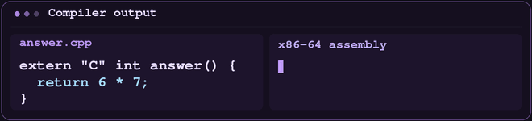
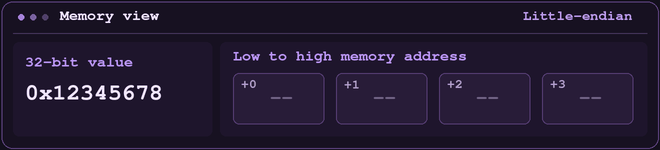

  

<h1 align="center">Hi, I'm Theekz</h1>

  I like reading compiler output and stepping through code to see what it actually does. 
  

## Tech stack

**Languages**

  
  

**Compilers & assemblers**

  
  
  
  
  

**Build & debug**

  
  
  
  
  
  

**Diagnostics**

  
  
  

**Version control & containers**

  
  
  

Web stack

  
  
  
  
  

  
  
  
  

  
  
  
  
  

## Small experiments

  <picture>
    <source media="(prefers-reduced-motion: reduce)" srcset="assets/compiler-preview.png">
    
  </picture>

  <picture>
    <source media="(prefers-reduced-motion: reduce)" srcset="assets/memory-view.png">
    
  </picture>

## GitHub activity

<!-- Activity graph by https://github.com/Ashutosh00710/github-readme-activity-graph -->

